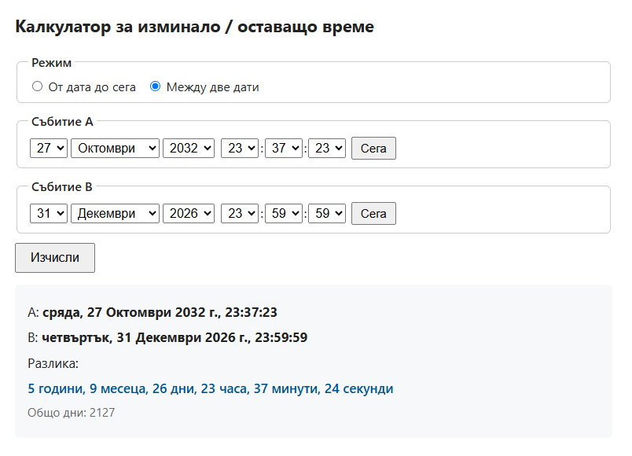

# time-between-dates

# Калкулатор за изминало / оставащо време

Малък, самостоятелен HTML/JavaScript инструмент за изчисляване на
разликата между две дати — с точност до секунда.

## Възможности

- **Режим „От дата до сега“** — колко време е изминало или остава до даден момент.
- **Режим „Между две дати“** — разлика между произволни два момента.
- Изчисление на **години, месеци, дни, часове, минути, секунди**.
- Коректна работа с **високосни години** и **лятно часово време**.
- Българска плурализация (1 година / 2 години).
- Живо обновяване всяка секунда в режим „до сега“.
- Без зависимости, без сървър — работи изцяло в браузъра.

## Демо

👉 https://chronobintern68478-cmyk.github.io/time-between-dates/

## Употреба

Отвори `index.html` в браузър. Няма нужда от build стъпка или сървър.

## Лиценз

[AGPL-3.0](LICENSE)

## История

Първоначалната идея идва от личен проект от началото на 2000-те,
пренаписан изцяло през 2025 г. с модерен JavaScript.
Част от кода е създадена с помощта на AI.
